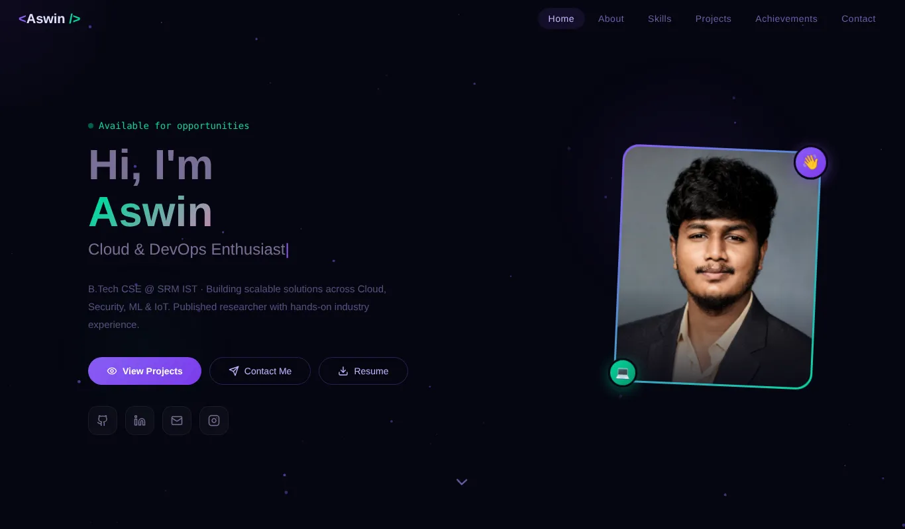
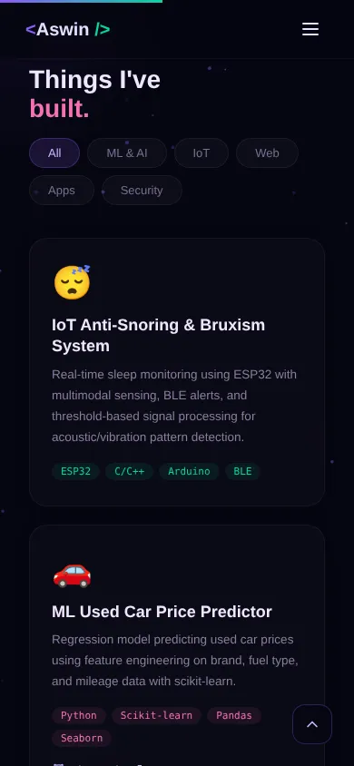

# Aswin — Developer Portfolio

**Live site:** https://aswin-portfolio-eosin.vercel.app

A dark-themed personal portfolio built with React: glassmorphism cards, an interactive particle background, animated stats, filterable projects, a timeline, certifications and publications.



<p align="center"></p>

## Features

- **Hero** with typewriter roles, profile photo and one-click resume download
- **About** with animated stat counters and a career/education timeline
- **Skills** grouped by category with animated progress bars
- **Projects** filterable by ML & AI, IoT, Web, Apps and Security, with links to source code
- **Certifications & publications**
- **Contact** section with social links
- Responsive layout with a full-screen mobile menu and a back-to-top button
- Accessible: skip link, labelled icon buttons, visible keyboard focus, `prefers-reduced-motion` support
- SEO-ready: Open Graph/Twitter preview image, sitemap, robots.txt, web manifest and favicon

## Tech stack

| Area | Tools |
| --- | --- |
| UI | React 18, Lucide React icons |
| Effects | Canvas particle system, CSS animations, IntersectionObserver |
| Build | Create React App (react-scripts 5) |
| Hosting | Vercel (caching + security headers in `vercel.json`) |
| CI | GitHub Actions: production build on every push |

## Project structure

```
aswin-portfolio/
├── public/
│   ├── index.html          # meta tags, fonts, noscript fallback
│   ├── profile.webp/.jpg   # profile photo
│   ├── Aswin_Resume.pdf    # resume served by the Resume button
│   ├── og-image.png        # link preview image
│   ├── favicon.svg, manifest.json, robots.txt, sitemap.xml
├── src/
│   ├── App.jsx             # all sections, components and content data
│   └── index.js
├── docs/                   # README screenshots
├── .github/workflows/      # CI build
└── vercel.json
```

## Run locally

Requires Node.js 18+ (see `.nvmrc`).

```bash
git clone https://github.com/Aswin20122005/aswin-portfolio.git
cd aswin-portfolio
npm ci
npm start        # http://localhost:3000
npm run build    # production build in build/
```

## Updating content

All content lives in the data arrays at the top of `src/App.jsx`:

- `PROJECTS`: add `repo: "https://github.com/..."` to show a **View code** link
- `CERTS`, `PUBLICATIONS`, `TIMELINE`, `SKILL_CATEGORIES`, `ROLES`

The stats counters (projects, publications, certifications) are calculated from these arrays automatically.

To replace the resume or photo, overwrite `public/Aswin_Resume.pdf` or `public/profile.webp` / `public/profile.jpg`.

## Deployment

Every push to `main` is deployed automatically by Vercel. To deploy a fork: import the repo at [vercel.com/new](https://vercel.com/new) and click **Deploy**. No configuration is needed.

## Contact

- GitHub: [@Aswin20122005](https://github.com/Aswin20122005)
- LinkedIn: [aswin-s-53abbb2a8](https://www.linkedin.com/in/aswin-s-53abbb2a8)
- Email: ashwin.20.achu@gmail.com
